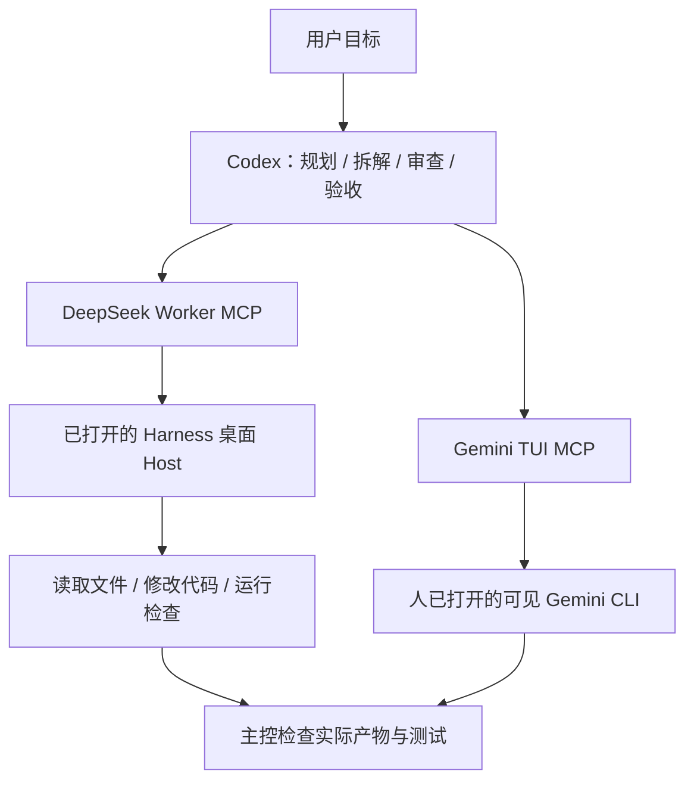

# Agent Orchestration MCP

**让 Codex 做规划与验收，通过 MCP 连接 DeepSeek Harness 执行端和可见的 Gemini CLI。**

这是从作者日常 Windows 开发环境整理出来的实验性工具集：包含实际使用过的两套桥接实现，而非只提供多模型对话提示词。当前以 Codex 为主控；Claude 主控和更多双向组合属于后续研发方向。

## 为什么做这个项目

我的出发点是：在目前自己的开发实践中，我更愿意把需求理解、规划、拆解和结果审查交给 Codex，把边界清楚的执行任务交给 DeepSeek Harness。对这些任务而言，我对 DeepSeek 执行能力的评价高于对它独立完成复杂规划的信任，因此希望主控持续保留判断和验收责任。

这是一种个人使用经验驱动的工程选择，不是“某模型永远更聪明”的结论，也没有跨模型统一基准测试或成本收益统计。模型能力会变化，任务也各不相同。项目要探索的是：**把规划、执行和验收分成明确职责，用 MCP 把不同工具连起来，发挥各自适合的作用。**

同样的思路可扩展到 Codex + Gemini、Claude + DeepSeek、Claude + Gemini，甚至 Claude + Codex。Claude 也是我看好的规划主控候选，但这些组合需要逐项实现、测试，不能因为使用 MCP 就默认全部可用。

## 当前实现

| 组合 | 已有能力 | 边界 |
| --- | --- | --- |
| Codex → DeepSeek Harness | 派发任务、读写文件与运行命令、进度查询、同会话续跑、取消、工作区管理；显式模式复用桌面 Host 与事件流 | 依赖 Harness 内部接口及本机登录；主控独立验收 |
| Codex → Gemini CLI | 连接已打开的可见原生 TUI，查询输出、发送文本和受限按键、退出会话 | 不是结构化 Worker 调度；不能把终端安静或文本送达当作执行完成 |
| Claude → DeepSeek / Gemini / Codex | 后续方向 | 尚未提供 Claude 端接入验收与 Codex 执行端适配器 |



## 目录

- `deepseek-worker/`：任务管理、STDIO MCP、桌面 Host 插件、兼容性探测与离线测试。
- `gemini-tui/`：可见终端宿主、回环 HTTP 客户端、STDIO MCP 与协议测试。
- `scripts/`：Windows 启动入口和 Gemini 启动脚本示例。
- `skills/controller/`：可供主控采用的协作规则。
- [安装与配置](docs/setup.md)、[验证与限制](docs/validation.md)。

## 快速开始

当前目标平台为 Windows，使用 Node.js 22+、PowerShell 7，以及自行安装并登录的 DeepSeek Harness / Gemini CLI。本仓库不附带第三方应用、账号、认证文件或模型服务。

```powershell
git clone https://github.com/dvdxfv/agent-orchestration-mcp.git
cd agent-orchestration-mcp
npm test
```

测试使用模拟 Worker / HTTP 宿主，不调用付费模型。运行测试成功不代表本机桌面已接入。继续按照[安装说明](docs/setup.md)配置应用和 MCP。

### DeepSeek 派工示例

先调用 `list_modes`，用 `add_workspace` 注册已有项目，再将实际返回的 `workspace_id` 填入：

```json
{
  "task": "复现指定缺陷，修复并运行相关测试，提供实际结果。",
  "mode": "standard",
  "workspace_id": "使用 add_workspace 返回的真实 ID",
  "workspace_path": "D:/Projects/example",
  "title": "修复导入去重问题",
  "scope": "仅修改导入逻辑与对应测试，保留其他修改。",
  "acceptance_criteria": "重复数据不再重复导入，相关测试通过。",
  "max_time_seconds": 900
}
```

`submit_task` 返回任务 ID；用 `get_task` 查询，`followup_task` 续跑，`cancel_task` 停止。`scope` 是任务约束，不是文件级 ACL。工作区写入使用 Harness 沙箱；不自动提交、推送或部署。同目录及父子目录并发受限，桌面 preset 任务与工作区操作串行。

## 验证状态

原始本机实现曾验证 DeepSeek 桌面实时展示、实际执行及同会话续跑；Harness `0.2.1-rc.2` 的兼容检查和标准模式有本机历史记录，其他模式不能据此视为新版已通过。极简模式曾因 Windows PTY 启动失败未通过验收。Gemini 原始桥接曾验证可见终端双向通信和两轮上下文，但本仓库整理后的路径配置仍需安装者进行实际桌面验收。

具体区分当前可重复离线检查和历史人工记录，见[验证与限制](docs/validation.md)。不承诺 macOS、Linux、任意未来 Harness 版本或不同 Gemini 安装布局均兼容。

## 安全与使用边界

桥接只监听回环地址并使用随机 Token，但本机授权文件仍是敏感数据。不要公开 `state/`、`tui-host-state.json`、账号配置、任务日志或私有项目上下文。`.gitignore` 不能代替发布前检查。接入权限等同于执行端实际拥有的能力，应只对可信主控开放。

DeepSeek 的 MCP 断连会取消该连接拥有的任务；桌面关闭会中断桌面任务。Gemini MCP 断连保留可见 TUI，结束时用 `close_session` 或手动 `/quit`。Gemini 不会由 MCP 静默启动，不自动同意终端中的审批。

## 后续研发方向

- 适配 Claude 主控，并验证 Claude → DeepSeek、Claude → Gemini 的实际流程。
- 研究 Codex 作为执行端，支持 Claude → Codex 等组合。
- 将执行证据、失败状态、恢复与人工审批约定做得更一致。
- 减少对 Harness 内部 API 与 Gemini 安装布局的依赖。

当前未实现自动模型路由、自动合并、同目录多 Worker 并发或任意模型互联。

## 项目归属与第三方依赖

这是个人实验项目，与 OpenAI、DeepSeek、Google、Anthropic 无隶属或官方背书关系。第三方软件需要独立安装并遵守各自条款。本仓库不重新分发 Harness preset 全量配置、第三方运行时或登录资料。当前未授予独立开源许可证；公开可读不等于无限制再分发许可。
